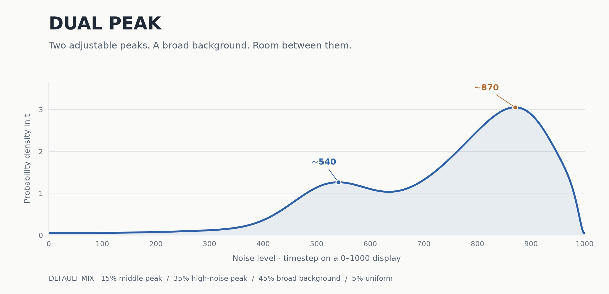

# Dual Peak

### Give your style more than one place to learn.


A configurable **training timestep sampler** for flow matching, built with style LoRAs in mind. Two peaks with their own positions, widths and weights, a broad background, and a little uniform coverage.



[Why I built it](#why-i-built-it) · [Quick start](#quick-start) · [Tune the curve](#tune-the-curve) · [How it works](#how-it-works)

## Why I built it

I wanted a style LoRA to pick up the palette, the way colors sit next to each other, the light and shadow, and the way the image is painted. The things that make the work recognizable before you zoom in.

Tiny strokes and surface texture matter too. They just weren't my first priority for this sampler.

I liked the idea behind [Style-Friendly SNR](https://arxiv.org/abs/2411.14793): give training more time at noise levels that matter for style. But I wanted another area of emphasis in the middle, with enough room between the two peaks to keep the curve broad.

That became Dual Peak: a smaller middle peak, a wider high-noise hill, and separate controls for both. You can move one without dragging the whole distribution along with it.

## What you get

- **Two places to focus.** Set each component's position directly in `t`. No need to guess a log-SNR mean to put a peak near 850.
- **Separate width and weight controls.** Broaden a peak without changing its assigned share, or give it more samples without changing its own position.
- **A broad background.** Keep coverage between the peaks and toward the noisy end. It contributes across the whole curve, not just the tail.
- **A small uniform floor.** Leave some probability everywhere. The default share is 5%.
- **A small PyTorch API.** One function returns a batch of timesteps on CPU or CUDA. No extra model, custom kernels, or trainer dependency.

The distinctive part is this particular curve and the control it gives you. Mixture distributions are established tools; [QingLong in Musubi Tuner](https://github.com/kohya-ss/musubi-tuner/blob/main/docs/advanced_config.md#qinglong_flux-and-qinglong_qwen-sampler-hybrid-sampler) also combines samplers. Dual Peak takes the idea in a specific direction: two explicitly positioned components, a separately controlled background, and a starting preset designed around palette, shading and painting technique.

**Those are design goals. Whether this produces a better style LoRA than your current sampler still needs a matched training comparison.**

## Quick start

Requires Python 3.10+ and PyTorch 2.0+. From your local clone:

```bash
pip install .
```

```python
from dual_peak_sampling import DualPeakConfig, sample_timesteps

config = DualPeakConfig()
t = sample_timesteps(batch_size=8, device="cpu", config=config)
# float32 tensor, shape [8]. Use device="cuda" to sample on your GPU.
```

Dual Peak chooses noise levels **during training**. Your image-generation sampler stays the same.

For the linear flow path `x_t = (1 - t) * x_0 + t * noise`, the training-side change looks like this:

```python
import torch
from dual_peak_sampling import sample_timesteps

def make_noisy_batch(x_0):
    t = sample_timesteps(x_0.shape[0], device=x_0.device)
    noise = torch.randn_like(x_0)
    t_broadcast = t.reshape(-1, *([1] * (x_0.ndim - 1)))

    x_t = (1 - t_broadcast) * x_0 + t_broadcast * noise
    target = noise - x_0
    return x_t, t, target
```

Pass these into your trainer's existing model and loss code. Check its timestep convention: this package uses `t = 0` for clean data and `t = 1` for noise. Some model interfaces need `1000 * t` or a separate conversion.

## The starting shape

| Component | Position | Width¹ | Weight |
| :--- | :--- | ---: | ---: |
| Middle peak | `t = 0.525` | `0.55` | `0.15` |
| High-noise peak | `t = 0.850` | `1.20` | `0.35` |
| Broad background | log-SNR mean `−3.2` | `2.20` | `0.45` |
| Uniform coverage | Entire interval | — | `0.05` |

¹ Width is measured in log-SNR, not in timesteps.

The component positions are 525 and 850 on a 0–1000 display. Once everything is added together, the **actual mixture peaks are near 540 and 870**. Changing the background or weights can move those maxima.

The default curve puts about 2.1% of samples in 0–300, 21.5% in 300–600, 58.6% in 600–900, and 17.8% above 900. These numbers describe where training samples land, not how much each interval improves the result. The horizontal axis is a noise level, not progress through your training run.

## Tune the curve

Here is the full default configuration. Start here, then change one thing at a time.

```python
config = DualPeakConfig(
    peak1_position=0.525,
    peak1_width=0.55,
    peak1_weight=0.15,
    peak2_position=0.850,
    peak2_width=1.20,
    peak2_weight=0.35,
    background_mean=-3.2,
    background_width=2.20,
    background_weight=0.45,
    uniform_weight=0.05,
)
```

| If you want to… | Change… |
| :--- | :--- |
| Move a component toward more noise | Increase its `position` |
| Spread that component over a wider area | Increase its `width` |
| Give that component more samples | Increase its `weight` |
| Give the broad background more influence | Increase `background_weight` |
| Shift the background toward more noise | Lower `background_mean` |
| Add more even coverage | Increase `uniform_weight` |

Weights are relative and normalized together. They do not need to add up to one. Each must be between 0 and 1, and at least one must be positive. Setting a weight to zero removes that component.

Think of a weight as a share of samples, not a height knob. At the same weight, a wider component has a lower peak. The components also overlap, so arbitrary settings may produce one visible hill instead of two.

## How it works

For each item in a batch, Dual Peak picks one component according to the normalized weights, then draws a timestep from it. It mixes distributions, rather than averaging sampled timesteps.

The three shaped components are normal distributions in log-SNR, mapped back to `t`. The fourth is uniform. Position-to-mean conversion accounts for that mapping, so the requested position is the peak of the individual component's density.

<details>
<summary><strong>The math and parameter limits</strong></summary>

For the linear flow path:

```text
log-SNR λ = 2 · log((1 − t) / t)
λ ~ Normal(μ, σ²)
t = sigmoid(−λ / 2)
```

For a component with desired mode `p` and log-SNR width `σ`:

```text
μ = −2 · [logit(p) − (σ / 2)² · (2p − 1)]
```

The resulting density includes the change-of-variable factor:

```text
f(t) = NormalPDF(2 · log((1 − t) / t); μ, σ) · 2 / [t(1 − t)]
```

Peak positions must lie strictly between 0 and 1. Peak widths are restricted to `(0, 2.8]`, keeping each of those components unimodal. The broad background takes a mean in `[-12, 6]` and a width in `(0, 6]`.

Samples are float32 and clamped to `[0.0001, 0.9999]`. The plotting function `density()` describes the continuous distribution before that clamp. It accepts floating tensors strictly inside `(0, 1)`.

</details>

<details>
<summary><strong>Reproducible sampling and plotting</strong></summary>

Use a generator on the same device as your samples:

```python
import torch
from dual_peak_sampling import DualPeakConfig, density, sample_timesteps

config = DualPeakConfig()
rng = torch.Generator(device="cpu").manual_seed(42)
t = sample_timesteps(4096, "cpu", config, generator=rng)

grid = torch.linspace(0.001, 0.999, 10000, dtype=torch.float64)
curve = density(grid, config)
```

Without a generator, the sampler uses PyTorch's global RNG. It does not reseed it or keep a separate random state. For exact continuation in the same environment, restore the RNG state with the rest of your training checkpoint.

To regenerate the README figure after installing the package:

```bash
pip install matplotlib
python assets/render_preview.py
```

</details>

## Trying it on a real style

For the first comparison, keep the dataset, captions, model, learning rate and training budget the same. Change the timestep sampler. Additional timestep shifts move this curve, and loss weighting changes how strongly its samples contribute, so keep those settings consistent too.

Compare on subjects and compositions that weren't in the training images. Look at the palette, color relationships, treatment of shadows and painting technique before judging the tiny details. If you share a result, include the baseline and the settings that produced both images.

The implementation has checks for the distribution, component positions, parameter validation, RNG restoration, and CPU/CUDA sampling. Those checks establish that the sampler follows its configuration. Image-quality comparisons are still to come.

```bash
pip install -e ".[test]"
python -m pytest
```

## Where the idea came from

- [Style-Friendly SNR Sampler for Style-Driven Generation](https://arxiv.org/abs/2411.14793) — the starting point for emphasizing high-noise training in style adaptation.
- [Kuon Noise's Anima style experiments](https://note.com/kuon_noise/n/n82be977f167d) — observations around the middle of the timestep range and the 800–900 region that helped shape this preset.
- [Musubi Tuner's hybrid sampling](https://github.com/kohya-ss/musubi-tuner/blob/main/docs/advanced_config.md#qinglong_flux-and-qinglong_qwen-sampler-hybrid-sampler) — related work combining several timestep distributions.

Dual Peak is my own configurable mixture built around those ideas. The two peaks are a starting hypothesis to test across styles, not a claim that every style lives in the same two windows.
